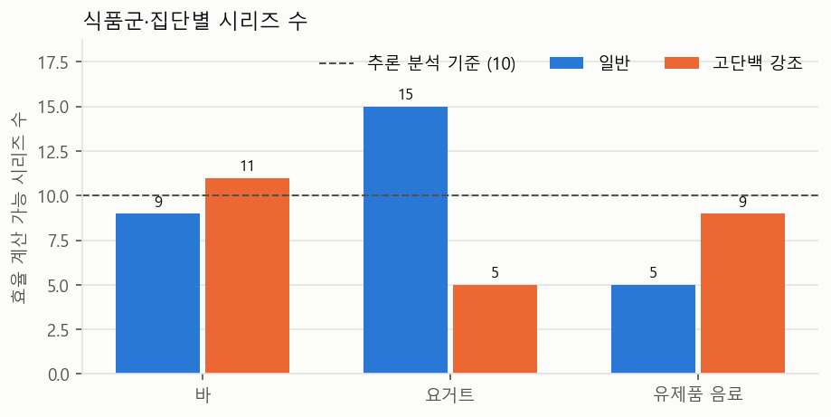
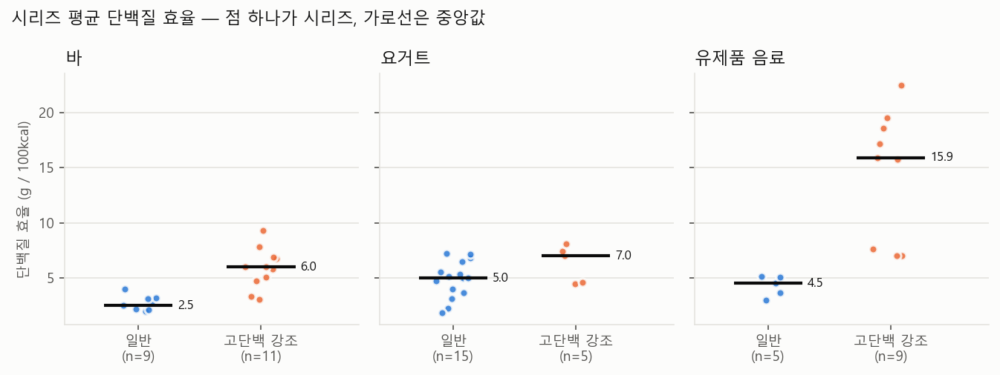
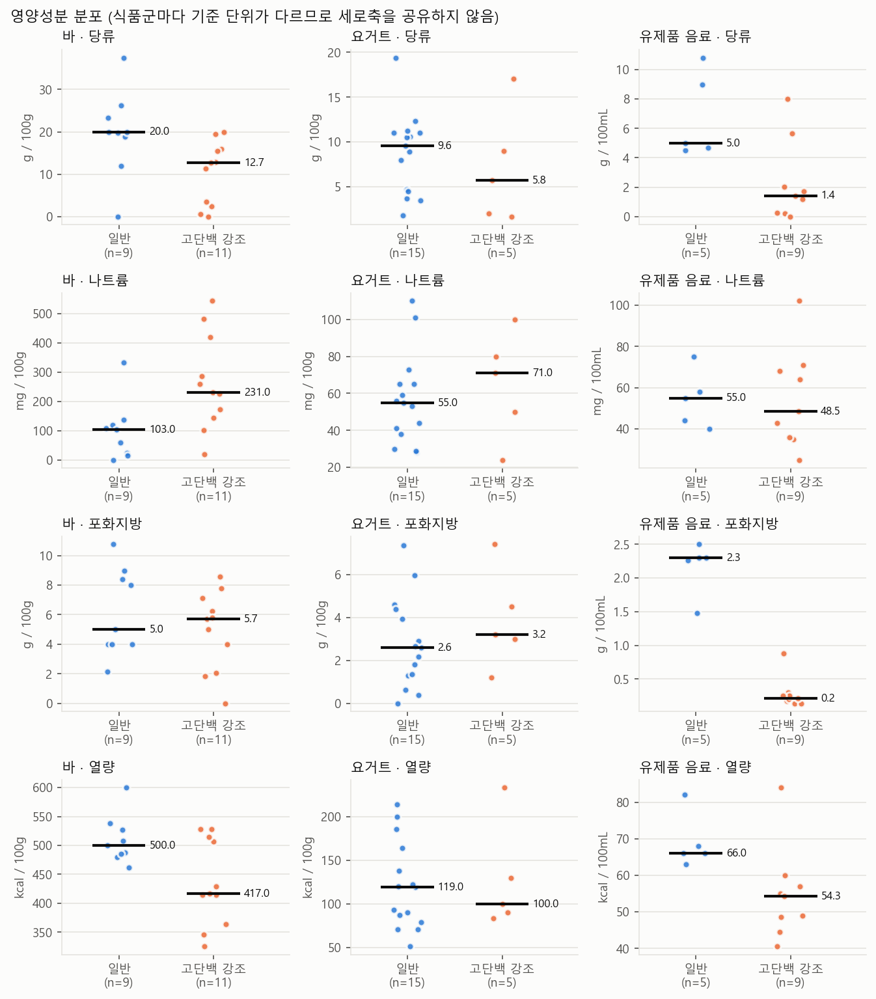
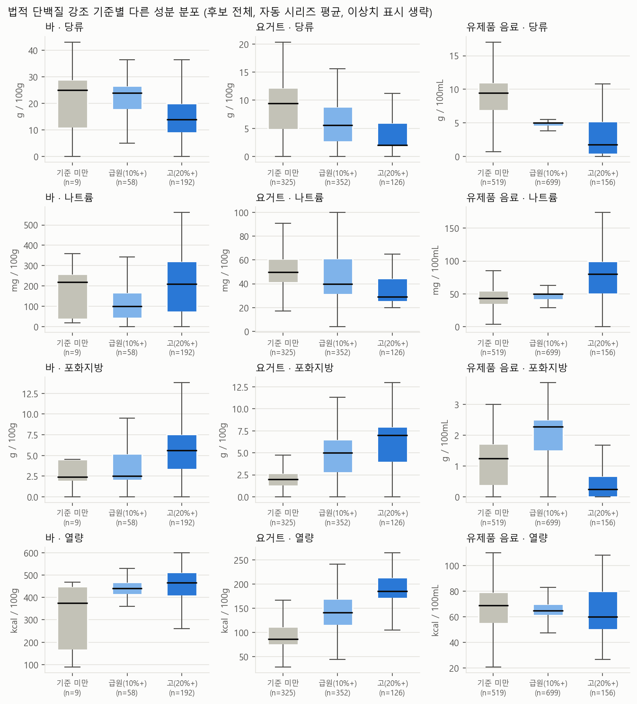

# 3. 탐색적 데이터 분석

> 담당: A · 상태: 초안 — **모든 수치는 `v000-draft`(A 판정만 반영) 기준이며 최종 데이터로 갱신해야 한다** · 코드: `04_eda.py`, `06_pool_protein.py`

## 질문

검정 전에, 두 집단의 분포는 어떻게 생겼고 식품군마다 검정할 만큼 시리즈가 있는가? 그리고 판정 없이 후보 전체를 보면 단백질 함량과 다른 성분은 어떤 관계인가?

## 3.1 표본 크기 (`eda_series_counts.png`)

명세서는 양 집단 각각 **효율 계산이 가능한 시리즈 10개 이상**이면 추론 분석에 넣기로 했다. 초안에서는 바 9/11, 유제품 음료 5/9, 요거트 15/5(일반/강조)로 어느 식품군도 아직 기준을 넘지 못한다. 확정된 근거 기준(포장·공식 페이지만 인정)으로 재검토하면서 판매 페이지·영양 앱에만 근거가 있던 제품은 보류로 바뀌었다. 공동 판정 14개와 B 담당분이 들어오면 대략 두 배가 될 것으로 예상하지만, **요거트 강조 집단은 여전히 빠듯하다.**

## 3.2 단백질 효율 (`eda_efficiency.png`)

점 하나가 시리즈 하나, 가로선은 중앙값이다.

| 식품군 | 일반 중앙값 | 강조 중앙값 |
|---|---|---|
| 바 | 2.5 | 6.0 |
| 요거트 | 5.0 | 7.0 |
| 유제품 음료 | 4.5 | 15.9 |

(단위 g/100kcal)

음료에서 차이가 가장 크고 요거트에서 가장 작다. 식품군마다 차이의 크기가 다르게 보인다는 점은 **확장 가설(상호작용)** 을 검정할 이유가 된다. 다만 식품군별로 "유의/비유의"를 나란히 놓는 것만으로 상호작용을 주장하지 않는다. 그 검정은 B가 회귀 모형으로 따로 한다.

## 3.3 다른 영양성분 (`eda_nutrients.png`)

식품군마다 기준 단위가 다르므로(바·요거트 100g, 음료 100mL) 세로축을 공유하지 않았다. 초안에서 눈에 띄는 패턴:

- **당류**: 세 식품군 모두 강조 집단이 낮다.
- **나트륨**: 바에서 강조 집단이 높다(중앙값 103 → 231mg).
- **포화지방**: 음료는 강조 집단이 낮고, 요거트는 높다.
- **열량**: 바·음료는 강조 집단이 낮고, 요거트는 높다.

요거트 강조 제품은 꾸덕한 그릭요거트가 많아 지방과 열량이 함께 높은 것으로 보인다. 이 그림의 세 성분(당류·나트륨·포화지방)은 머신러닝의 입력과 같으므로, 두 집단이 얼마나 겹치는지 미리 볼 수 있다.

## 3.4 보조 분석: 함량 기준으로 본 후보 전체 (`pool_protein_levels.png`)

판정 표본이 작다는 한계를 보완하기 위해, 판정 없이 후보 3,431개(자동 시리즈 2,436개) 전체를 **식약처 단백질 강조표시 기준**으로 나눴다. 1일 기준치 55g 대비 바·요거트는 100g당 5.5g 이상 "급원", 11g 이상 "고", 음료는 100mL당 그 절반이다. 100kcal당 기준은 효율과 같은 값이라 쓰지 않았다.

단백질 함량과의 순위상관(Spearman, 기술 통계):

| 식품군 | 당류 | 나트륨 | 포화지방 | 열량 |
|---|---|---|---|---|
| 바 | -0.46 | 0.50 | 0.29 | 0.06 |
| 요거트 | -0.41 | -0.33 | 0.59 | 0.71 |
| 유제품 음료 | -0.45 | 0.31 | 0.14 | 0.04 |

광고 기준 표본과 같은 방향이 보인다. 단백질이 많을수록 당류는 낮고, 요거트에서는 열량·포화지방이 높다. 판정 표본의 패턴이 우연한 추출 결과만은 아닐 가능성을 시사한다.

## 3.5 광고와 법적 기준 (`claim_vs_legal.csv`)

판정 표본에서 "단백질을 강조한" 제품이 법적 "고" 기준을 충족하는지 셌다.

| 식품군 | 강조 제품 중 법적 "고" 충족 |
|---|---|
| 바 | 13 / 13 |
| 유제품 음료 | 12 / 15 |
| 요거트 | **0 / 8** |

요거트 강조 제품은 100g당 11g 기준에 한 개도 미치지 못했다. 법은 1회 섭취참고량 기준 등 다른 경로도 허용하므로 표시가 위법이라는 뜻은 아니지만, **"고단백"이라는 인상과 실제 함량 사이의 간극**을 보여 준다.

## 한계

- 모든 수치는 초안이다. 최종 데이터로 다시 실행해 갱신한다.
- 그림은 분포를 보는 용도이며 검정 결과가 아니다.
- 보조 분석의 자동 시리즈는 근사치이며, 범위 밖 제품(프로틴 워터 등)이 일부 섞일 수 있다.
- 법적 기준 수치는 보조 출처로 확인했으며 식약처 원문으로 최종 확인이 필요하다.
