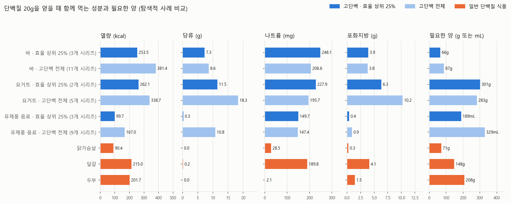

# 4. 사례 비교: 단백질 20g을 얻는 데 드는 "비용"

> 담당: A · 상태: 초안 (`v000-draft` 기준) · 코드: `05_food_comparison.py`

## 질문

효율이 가장 좋은 고단백 제품은 닭가슴살·달걀·두부 같은 일반적인 단백질 식품과 비교하면 어떤가? 같은 단백질을 얻을 때 무엇을 얼마나 더 먹게 되는가?

## 방법과 이유

**같은 단백질 섭취 조건**으로 맞춘다. 단백질 20g은 한 끼에 흔히 목표로 삼는 양이다.

- 함께 먹는 성분 = 성분 ÷ 단백질 × 20 (열량·당류·나트륨·포화지방)
- 필요한 양 = 기준량 ÷ 단백질 × 20 (g 또는 mL)

계산 순서는 **제품별 값 → 시리즈 평균 → 식품군 평균**이다. 맛이 많은 시리즈가 결과를 지배하지 않게 하기 위해서다.

비교 대상은 사전에 정한 기준으로 골랐다.

| 식품 | 사용 항목 | 출처 |
|---|---|---|
| 닭가슴살 | 껍질 제거, 삶은 것, 무첨가 | 농촌진흥청 국가표준식품성분표 |
| 달걀 | 전란, 삶은 것 | 농촌진흥청 국가표준식품성분표 |
| 두부 | 일반 두부, 양념·기름 없음 | 주자료의 농촌진흥청 성분표 행 |

고단백 제품은 두 범위로 본다.
- **효율 상위 25%**: 식품군별 강조 시리즈 중 효율 75백분위 이상 (경계 동률 포함)
- **강조 제품 전체**

## 입력·출력

`products.csv`, `series_statistics.csv`, `raw_foods_rda.csv` → `reference_foods.csv`, `food_comparison.csv`, `food_comparison.png`

## 결과 (초안)

| | 필요량 | 열량 | 당류 | 나트륨 | 포화지방 |
|---|---|---|---|---|---|
| 닭가슴살 | 71g | 90kcal | 0g | 29mg | 0.3g |
| 달걀 | 148g | 215kcal | 0.2g | 190mg | 4.1g |
| 두부 | 208g | 202kcal | 0g | 2mg | 1.5g |
| 바 · 상위 25% | 66g | 253kcal | 7.3g | 248mg | 3.9g |
| 음료 · 상위 25% | 189mL | 100kcal | 0.3g | 150mg | 0.4g |
| 요거트 · 강조 전체 | 283g | 339kcal | 18.3g | 196mg | 10.2g |

## 해석

- **효율 상위 고단백 음료**는 열량·당류·포화지방이 닭가슴살과 비슷한 수준이다. 나트륨은 닭가슴살보다 높다.
- **고단백 바**는 양이 가장 적게 들지만(66g), 같은 단백질에 열량이 닭가슴살의 약 2.8배이고 당류와 나트륨이 따라온다.
- **고단백 요거트**는 단백질 20g을 얻으려면 열량·당류·포화지방을 가장 많이 함께 먹게 된다. EDA에서 본 "요거트 강조 제품은 법적 '고' 기준에 미치지 못한다"는 결과와 맞물린다.

## 해석할 때 주의

- **단백질 20g당 열량은 효율의 역수(2000 ÷ 효율)** 다. 효율 결과와 독립된 새 발견으로 세지 않는다.
- 상위 25%는 같은 데이터에서 효율로 고른 집단이다. "고단백 제품이 닭가슴살만큼 좋다"는 일반화가 아니라 **탐색적 사례**로만 해석한다.
- 일반 식품은 대표값 한 개씩이며, 여러 표본인 것처럼 검정하지 않았다.
- 초안에서 요거트 상위 25%는 시리즈 2개뿐이다. 최종 데이터에서 다시 확인한다.
- 조리 방식(삶음)과 가공식품(그대로 섭취)의 비교라는 차이가 있다.
